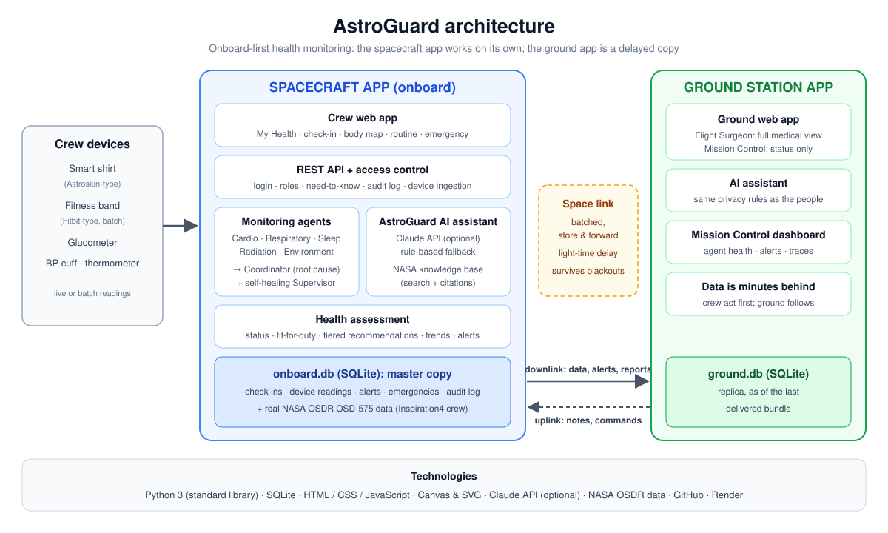

# AstroGuard Architecture



## The big idea: onboard-first
On a Mars mission, Earth is up to 22 minutes away and sometimes unreachable for weeks. So the
**spacecraft app does everything on its own**: monitoring, alerts, guidance and emergencies.
The **ground station app** is a delayed copy for the flight surgeon and mission control.

## Components

### Spacecraft app (onboard)
| Component | What it does |
|---|---|
| **Crew web app** | Each astronaut's personal screen: My Health, check-in, body map, routine, privacy, emergency. Commanders and Crew Medical Officers also get the crew board. |
| **REST API + access control** | Login, roles and need-to-know rules, enforced on the server for every request (and for the AI). Every view of someone else's data is logged. |
| **Device ingestion** | Accepts live or batch readings from smart shirts, fitness bands, glucometers and BP cuffs. See [DEVICES.md](DEVICES.md). |
| **Monitoring agents** | Five rule-based agents (cardio, respiratory, sleep, radiation, environment) check every reading. A **coordinator** finds the root cause (cabin problem vs. personal), and a **supervisor** restarts any agent that fails. |
| **Health assessment** | Turns readings into status, fit-for-duty, tiered recommendations (self-care / CMO / flight surgeon) and 14-day trends. |
| **AstroGuard AI assistant** | Chat panel on every screen. Uses the Claude API when a key is configured, otherwise a rule-based assistant. Answers from the user's own data and a NASA-based knowledge base, with citations. |
| **onboard.db** | The master database (SQLite), including the real NASA OSDR OSD-575 reference data. |

### Ground station app (Earth)
| Component | What it does |
|---|---|
| **Ground web app** | Flight surgeon: full medical view and private messages to the crew. Mission control: operational status only. |
| **Mission Control dashboard** | Watches the monitoring agents themselves: health, alerts, traces. |
| **ground.db** | A replica of the spacecraft database, as of the last delivered message. |

## How data flows
1. **Devices and check-ins → spacecraft:** readings arrive live or in batches and are validated and stored.
2. **Agents → alerts:** the agents analyze each reading; the coordinator raises alerts with a root cause.
3. **Spacecraft → ground (downlink):** every few seconds a batch of changes is sent over the simulated space link, delayed by the light-time and held during blackouts. See [SYNC.md](SYNC.md).
4. **Ground → spacecraft (uplink):** flight surgeon notes and mission control commands travel back up with the same delay.

## Privacy by design
Following NASA practice, medical details stay between each astronaut and the flight surgeon.
Crew Medical Officers see a crewmate's vitals only on a health warning, when shared, or in an
emergency. The commander and mission control see fit-for-duty only. The AI follows the same rules.

## Technologies
| Layer | Technology |
|---|---|
| Backend (both apps) | Python 3 (standard library only) |
| Database | SQLite: one shared design, a separate copy per app |
| Frontend | HTML, CSS, JavaScript (no framework), Canvas charts, SVG body map |
| AI assistant | Claude API (optional) with a rule-based fallback |
| Knowledge base | Summaries of NASA health guidance plus real NASA OSDR data, searched with BM25 |
| Sync | Store-and-forward link over HTTP, inspired by NASA's delay-tolerant networking |
| Security | Signed sessions, role-based need-to-know access, audit log |
| Hosting | GitHub (code), Render (live demo) |

## Project layout
```
spacecraft_app.py      spacecraft (onboard) app
ground_app.py          ground station app
run_mission.py         starts both apps, linked by the simulated space link
run_demo.py            all-in-one demo (every role on one server)
astroguard/            shared code
  core/                agents, health assessment, access rules, guides, knowledge base, AI assistant
  db/                  the shared database design + sync helpers
  sync/                the store-and-forward space link
  ingest/              device data intake
  sim/                 crew and habitat data simulator
  server/              web server and API
ui/                    web pages (crew & ground app, Mission Control)
datasets/osdr/         real NASA OSDR OSD-575 data (unchanged)
tools/                 device data simulator
docs/                  architecture, sync and device docs
```
