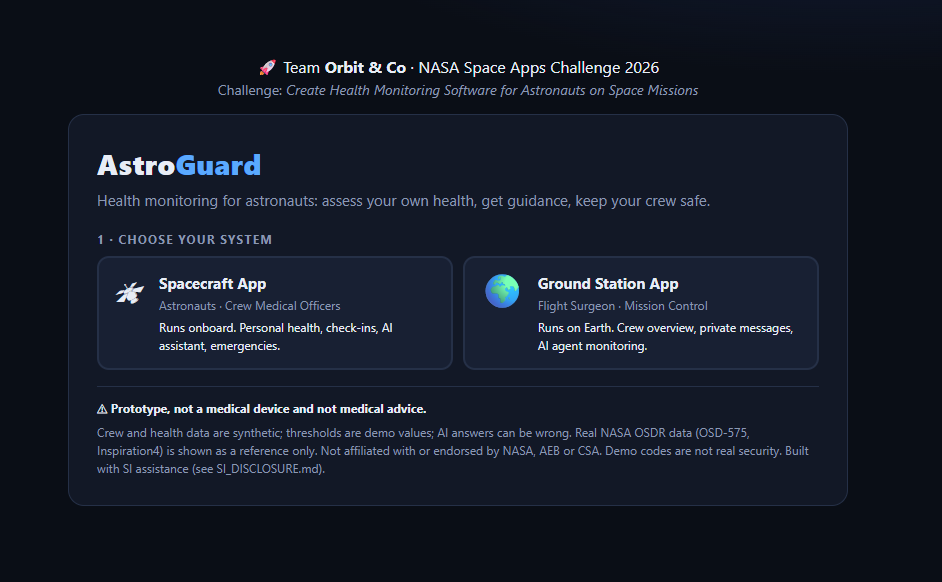
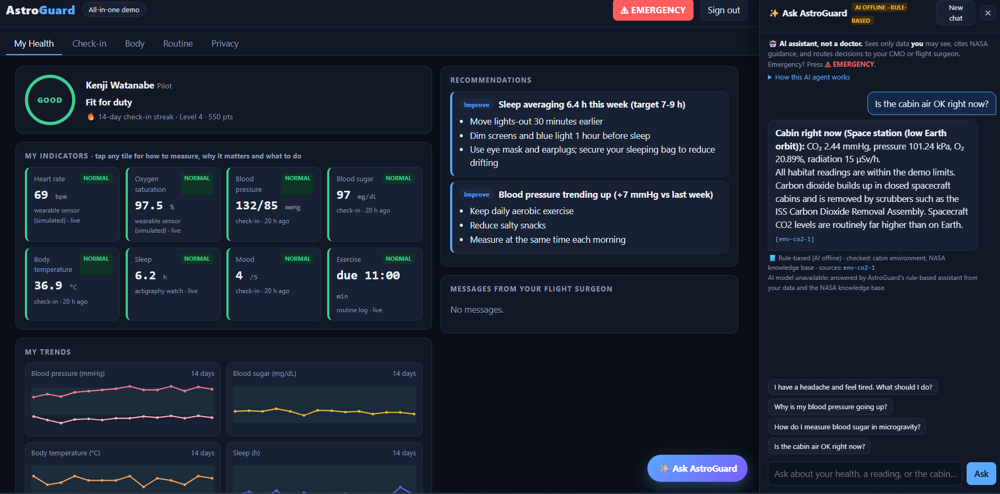
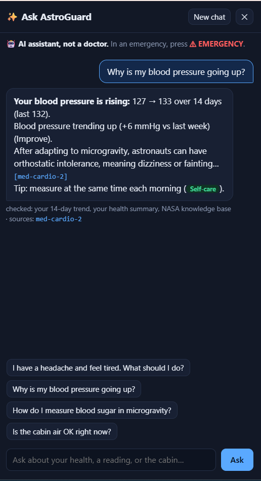
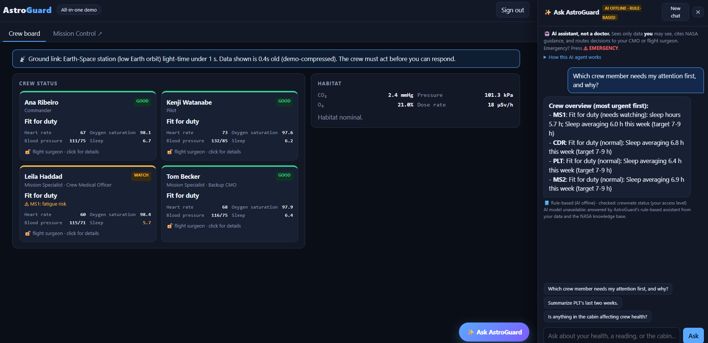
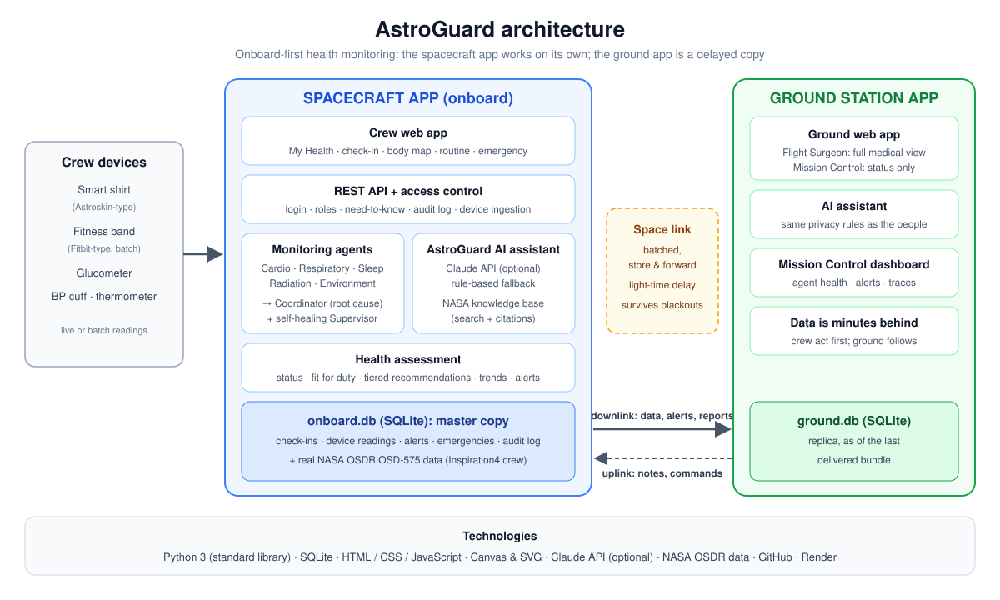

# AstroGuard: Health Monitoring for Astronauts on Space Missions

**NASA Space Apps Challenge 2026: Create Health Monitoring Software for Astronauts on Space Missions**
(challenge by the Brazilian Space Agency, AEB) · Team **Orbit & Co**

🌐 **Live demo:** https://astroguard-a3xh.onrender.com (free hosting: the first load may take up to a minute to wake up. Demo codes are on the login screen.)
💻 **Code:** https://github.com/mythilias/nasa-spaceapp-hackathon-astroguard

> *Three months into the journey to Mars, an astronaut wakes up with a headache and feels unusually tired. Is it the cabin air, poor sleep, or something more? The flight surgeon is 12 minutes away.*

Today's astronaut health monitoring depends on the ground: wearables send data down and flight
surgeons interpret it. Halfway to Mars, Earth is **up to 22 minutes away**, and for about two weeks
every two years (solar conjunction) it can't be reached at all. **AstroGuard** moves health
monitoring onboard:
- a personal health app for every astronaut,
- AI agents that reason about health with the same privacy rules as the humans, and
- a ground station that stays in sync over a realistic delayed space link.

## Screenshots
**Choose your system:** a spacecraft app for the crew and a ground station app for mission control.


**Astronaut dashboard with the AstroGuard AI assistant:** personal vitals, trends, recommendations, and an assistant docked on every screen.


**AstroGuard AI assistant:** short answers from the astronaut's own data, with NASA sources.


**Ground station, flight surgeon view:** the whole crew's health with the link delay, and the assistant ranking who needs attention first.


## What makes it different
| | |
|---|---|
| 🛰 **Runs onboard, mirrors to Earth** | Two apps, **spacecraft and ground station**, each with its own copy of one common database, synced in **batches** over a simulated store-and-forward space link (inspired by NASA's Delay/Disruption Tolerant Networking). Real light-time delay, and a solar-conjunction blackout in which nothing is lost. See [docs/SYNC.md](docs/SYNC.md). |
| ⌚ **Plugs into real devices** | A device ingestion API for smart shirts (Astroskin-type), fitness bands (Fitbit-type batches), glucometers and BP cuffs: live or batch, validated, de-duplicated, labeled by source. See [docs/DEVICES.md](docs/DEVICES.md). |
| ✨ **Privacy-aware AI agents** | A Claude-powered **Medical Assistant** whose tools run with the **asker's own permissions**, so the AI can't see more than the person asking. Plus an **AI ground-briefing agent** that writes a situation report so one delayed message carries everything. |
| 🧑‍🚀 **Built for non-doctors** | Every indicator explains how to measure it in space, why it matters, what's normal and what to do. Emergency protocols are step by step. |
| 🔒 **Follows NASA medical-privacy practice** | Medical data stays between the astronaut and the flight surgeon; two Crew Medical Officers; need-to-know for everyone else; "who viewed my data" log. |
| 🤖 **Multi-agent monitoring** | 5 rule-based specialist agents for detection (fast, predictable, offline), a coordinator for root cause, AI for reasoning and communication, and a self-healing supervisor. |

## Features

**For each astronaut** (onboard node, personal sign-in)
- **My Health:** color-coded status, fit-for-duty, live wearable data (heart rate, SpO2, sleep) plus check-ins (blood pressure, blood sugar, body temperature, mood), 14-day trends.
- **Tap any indicator** for a measuring guide, why it matters (linked to NASA's five spaceflight hazards), the normal range and what to do.
- **Tiered recommendations:** *Self-care*, *Crew Medical Officer* or *Flight surgeon*, plus trend-based improvement tips.
- **Clickable body map**, **daily routine with reminders, points, streaks and badges**.
- **✨ Ask AstroGuard:** the AI Medical Assistant docks on the right of **every screen**, like a coding assistant in an editor. Ask *"I have a headache and feel tired"*: it checks your vitals, trends and cabin CO2, cites NASA guidance and suggests next steps. It knows which screen you're on, and every indicator guide has an "Ask AstroGuard about my reading" button.
- **⚠ EMERGENCY mode:** guided protocols (chest pain/collapse, low oxygen, radiation storm, fainting), live patient vitals, and an AI-written **SBAR report** sent down to the flight surgeon.
- **Privacy:** choose whether the Crew Medical Officers see your vitals and mood; see every view of your data.

**For the ground** (ground node, delayed copy of the spacecraft's data)
- **Flight surgeon:** full medical view, private messages that travel up the link, AI assistant.
- **Mission Control:** operational status only, agent observability, demo scenario controls, mission environment and **link blackout** simulation. Ground commands travel up the delayed link.

### Who sees what (enforced on the server)
| | Astronaut | Crew Medical Officers (2) | Commander | Flight Surgeon | Mission Control |
|---|---|---|---|---|---|
| Vitals & trends | ✅ own | On a health warning, or if shared | Status only | ✅ | Status only |
| Mood | ✅ own | Only if shared | ❌ | ✅ | ❌ |
| Fit-for-duty & task restrictions | ✅ | ✅ | ✅ | ✅ | ✅ |
| **Medical emergency** | The crew sees the patient's vitals (not mood) to treat them, and every view is logged | | | | |

Private mood never changes the status or duty label others see, so it can't be inferred. **The AI
agents follow the same table:** a commander asking the AI about a crewmate gets operational status only.

#### Why these rules: following NASA practice
| Rule | Basis |
|---|---|
| Medical details stay between the astronaut and the flight surgeon | Routine **private medical conferences** to protect privacy under the **Privacy Act of 1974** ([NASA-STD-3001 / HIDH 3.0](https://www.nasa.gov/reference/3-0-health-and-medical-care/)); astronaut medical records are protected by the Privacy Act and HIPAA ([NASA LSAH](https://nlsp.nasa.gov/explore/lsdahome/lsahhome)) |
| **Two** Crew Medical Officers (Leila, plus Tom as backup) | NASA requires at least two crewmembers per vehicle trained as CMOs ([HIDH 5.0 Training](https://www.nasa.gov/reference/5-0-training/)) |
| Minimum necessary access | Strict reading of the Privacy Act; fear of losing flight assignments discourages honest reporting ([National Academies, *Safe Passage*](https://www.nationalacademies.org/read/10218/chapter/8)) |
| Commander and Mission Control see operational status | **Our design assumption.** We found no public NASA document on exactly what a commander receives |

## Run it

**Two-node mission (recommended for demos):**
```bash
python run_mission.py --reset
#   ONBOARD (crew):                 http://127.0.0.1:8000
#   GROUND  (surgeon, mission ctl): http://127.0.0.1:8001
```
**All-in-one (simplest):** `python run_demo.py --reset`, then open http://127.0.0.1:8000. All six roles are on one server, with the ground delay simulated.

**Feed sample device data** (smart shirt, fitness band, glucometer, BP cuff): `python tools/device_simulator.py`. See [docs/DEVICES.md](docs/DEVICES.md).

Needs **Python 3.10+ only**. The core needs no packages and no internet.

**Enable the AI agents (optional):** run `pip install anthropic`, then create a file named `.env` in this folder containing `ANTHROPIC_API_KEY=sk-ant-...`. The file is git-ignored. Without a key, AstroGuard uses rule-based guidance and template reports, so it works the same way an onboard system would with no AI available.

| Demo login | Code | Role | Node |
|---|---|---|---|
| Ana Ribeiro | `4821` | Commander | Onboard |
| Kenji Watanabe | `7316` | Pilot | Onboard |
| Leila Haddad | `2094` | Mission Specialist · Crew Medical Officer | Onboard |
| Tom Becker | `5583` | Mission Specialist · Backup CMO | Onboard |
| Dr. Priya Nair | `9001` | Flight Surgeon | Ground |
| Flight Director | `3000` | Mission Control | Ground |

Deep links for demos: `http://127.0.0.1:8000/#code=7316&view=health` (views: `health`, `checkin`, `body`, `routine`, `crew`, `privacy`, `ops`; `ask` opens the assistant panel). Each browser tab keeps its own login.

## Architecture


Two apps share one codebase: the **spacecraft app** runs everything onboard (monitoring agents, AI
assistant, health assessment, master database), and the **ground station app** is a delayed copy for
the flight surgeon and mission control, synced in batches over a simulated space link.

📄 **Full details:** [docs/ARCHITECTURE.md](docs/ARCHITECTURE.md) (components, data flow, technologies, project layout)
· [docs/SYNC.md](docs/SYNC.md) (how syncing works) · [docs/DEVICES.md](docs/DEVICES.md) (device integration)

## Real NASA data in the app
AstroGuard loads **NASA OSDR [OSD-575](https://osdr.nasa.gov/bio/repo/data/studies/OSD-575)**, the Inspiration4 crew's comprehensive metabolic panel: 19 blood markers for 4 astronauts at 7 timepoints, from 92 days before launch to 194 days after return. The file is stored unchanged in `datasets/osdr/` and processed by `astroguard/core/nasa_data.py`. It's used to:
- show **"how a real crew compared"** next to an astronaut's own blood sugar (in the indicator guide), and calcium, electrolytes and kidney markers on the **body map**;
- generate **knowledge-base passages from the real numbers**, which the AI assistant and alert explanations cite (`[osdr-575-glucose]`, …);
- give the AI a `get_spaceflight_reference` tool.

## NASA and partner resources used
- **NASA Human Research Program:** five hazards of human spaceflight and risk evidence (cardiovascular, sleep, behavioral health, immune, bone, SANS, radiation). These are the basis of the knowledge base.
- **NASA-STD-3001 / Human Integration Design Handbook:** atmosphere and radiation themes; private medical conferences, the Privacy Act and two CMOs per vehicle, which shaped the access rules.
- **NASA Open Science Data Repository (OSDR):** spaceflight biology context, including the open Inspiration4 crew data (blood counts and metabolic panels; [SOMA](https://www.nasa.gov/osdr-latest-news-soma-publications)). This is the planned source for real reference ranges in a next version.
- **Canadian Space Agency Bio-Monitor (Astroskin):** the [space-qualified wearable](https://www.asc-csa.gc.ca/eng/sciences/astroskin.asp) whose measurements (heart rate, ECG, blood pressure, breathing, SpO2, temperature) informed which "wearable" indicators AstroGuard assumes are available.
- **NASA Delay/Disruption Tolerant Networking:** the inspiration for the store-and-forward link design.

## Limitations
- **Onboard AI:** the demo uses a cloud AI model; a Mars mission would need it to run on the spacecraft.
- **Real health data:** would require formal privacy agreements, encryption and stronger login security.
- **Prototype only:** synthetic crew data and demo thresholds, not validated for clinical use.

## Disclaimer
- **Not a medical device and not medical advice.** AstroGuard is a hackathon prototype. Do not use it to make health decisions.
- **Synthetic data:** the crew are fictional and all crew health data is computer-generated. Thresholds are demo values, not clinical limits.
- **AI can be wrong.** AI answers are labelled, cite their sources and route decisions to qualified humans, but they may contain errors.
- **Real NASA data** (OSDR OSD-575, Inspiration4) is used unchanged as a *reference* for comparison only. It covers four civilian crew on a three-day mission and is not a clinical norm. Knowledge-base passages are paraphrased summaries of NASA guidance; check them against the primary sources.
- **No affiliation:** this project is not affiliated with, sponsored by or endorsed by NASA, the Brazilian Space Agency (AEB), the Canadian Space Agency (CSA) or Anthropic. No NASA logos or branding are used.
- **SI use:** developed with assistance from Claude Code; see [SI_DISCLOSURE.md](SI_DISCLOSURE.md).
- Built by team **Orbit & Co** for the NASA Space Apps Challenge 2026.

## Beyond space
The same offline-first, guided, privacy-respecting design could serve **remote communities on Earth**
with limited access to healthcare, such as research stations, ships and rural clinics.

## License
MIT. See [LICENSE](LICENSE).
